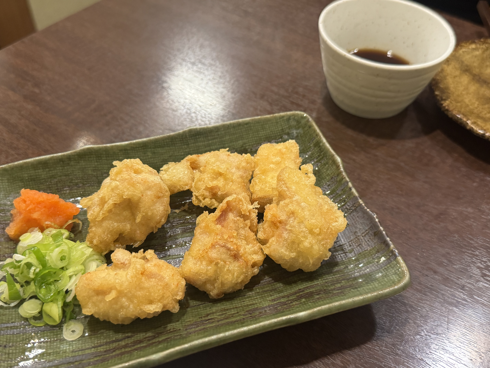
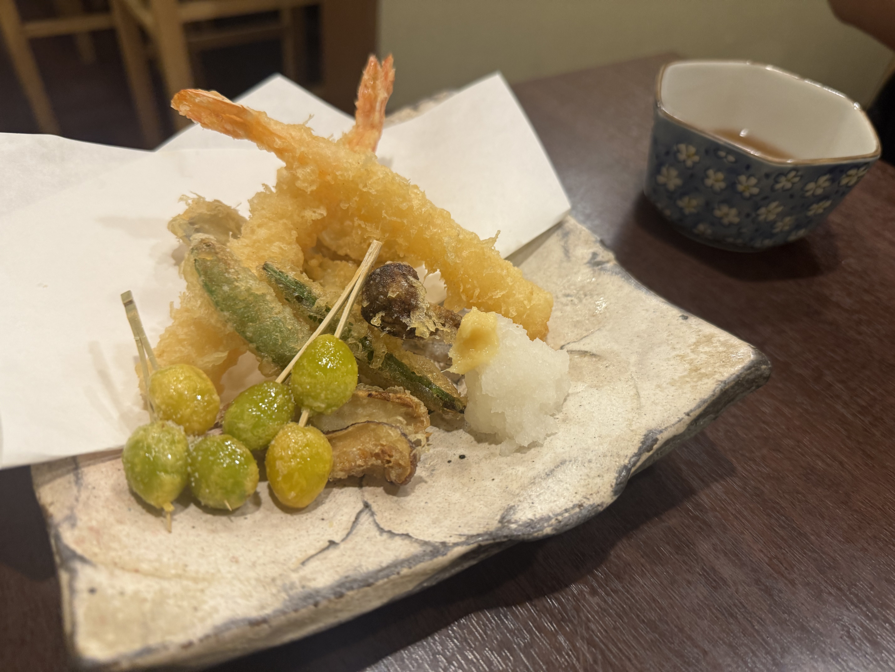
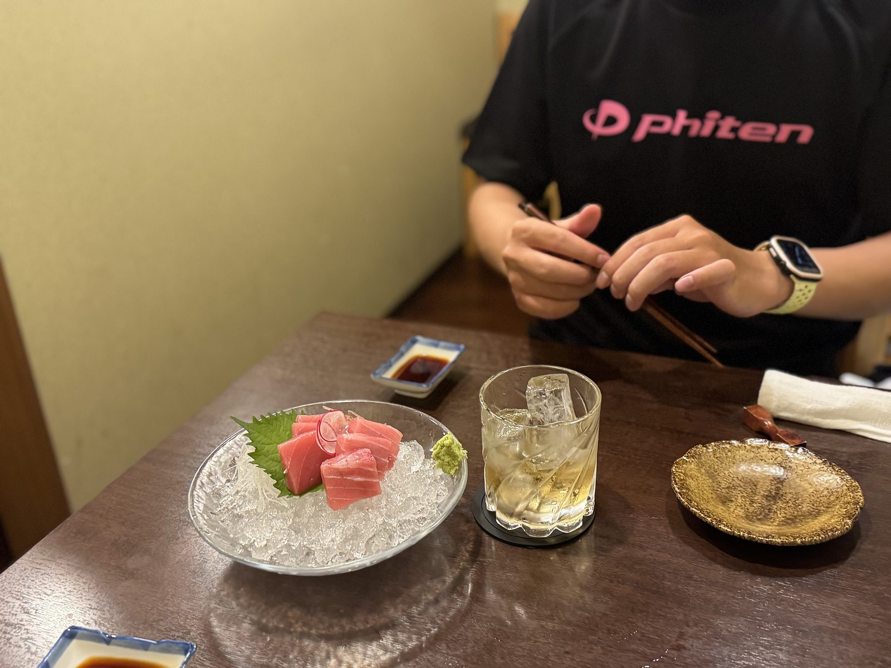
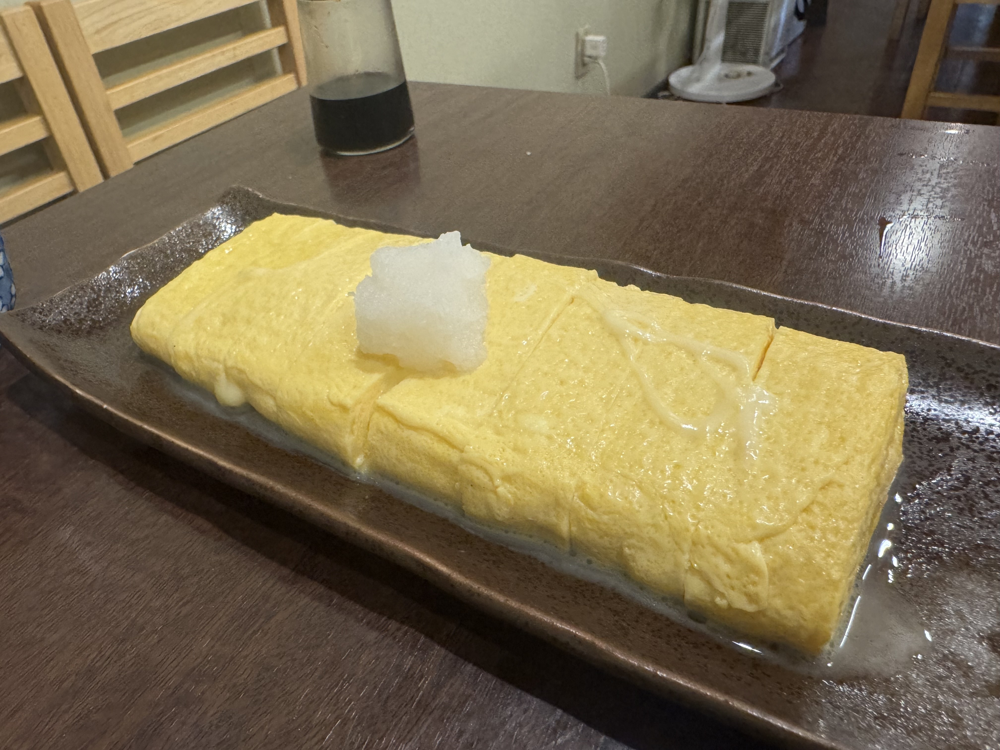
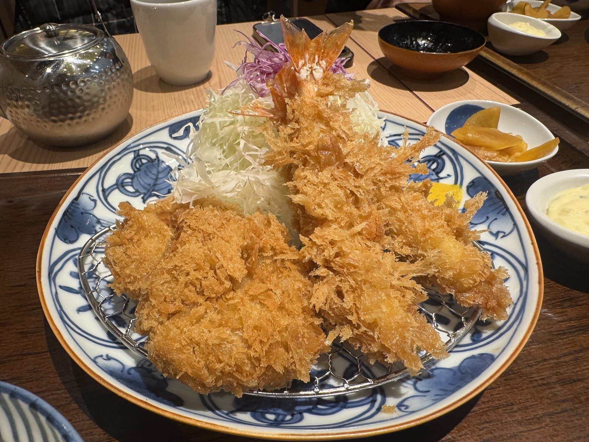

## まだ、日本です

卒業旅行でヨーロッパに行ってきました。\
10/16〜22の7日間で、オランダ・ベルギー・ドイツです。

シリーズにして書いていきます。\
ただ第0回の今回、ヨーロッパは出てきません。堺と関空の話です。

静岡から関空の便なので、前日に大阪へ入りました。\
前乗りの夜は、ごはんに使いました。

## 堺の「和処つくし」

向かったのは、阪堺線・大小路駅から徒歩2分の「和処つくし」さん。\
「隠れ家居酒屋」の看板どおり、本当にひっそりしています。

中は明るくて清潔で、カウンターの奥では店主さんが静かに手を動かしています。\
アラカルトは50種類以上。メニューを眺めているだけで10分くらい経って、そのあいだ誰も喋らない。いい夜です。

明日から一週間、和食とはお別れです。\
この夜は、日本の味を食べておくことにしました。

### とり天

最初に来たのがこれ。\
衣は軽くてふわっとしていて、鶏はしっとり。\
紅葉おろしと青ねぎを乗せて、ポン酢でいただきます。

さっぱりしているのに、ちゃんと満足する。\
「とり天、好きかも」と思ったところで、次の皿が来ました。

### 天ぷら盛り合わせ

海老、ししとう、椎茸、そして串に刺さった銀杏。\
銀杏を串に通して揚げる、という手間をさらっとやってくれます。

大根おろしと一緒だと、とり天とは別の軽さです。\
秋の盛り合わせ、という一皿でした。

### マグロのお造りと梅酒

ここでお造り。\
氷の上のマグロは色がきれいで、口に入れるとすっと溶けます。\
店主さんが、毎朝仕入れているそうです。

添えは梅酒のロック。\
刺身と梅酒、やってみると案外しっくりきます。\
出発の前夜には、これが一番やさしい一杯でした。

### だし巻き玉子

〆はだし巻き。見てください、この**長さ**。\
お皿いっぱいに横たわっています。

箸を入れると、出汁がじゅわっとあふれてきます。\
大根おろしを乗せて、お醤油を一滴。

派手さはないのに、この夜いちばん残ったのはこれでした。\
「しばらく、だし巻きとはお別れだね」と言いながら食べました。

===店舗情報===\
店名: 和処つくし\
リンク: [ホットペッパー](https://www.hotpepper.jp/strJ000985704/) ・ [食べログ](https://tabelog.com/osaka/A2705/A270501/27054609/)\
住所: 大阪府堺市（阪堺線・大小路駅 徒歩2分）

## 関空の和幸

翌朝、関西国際空港。\
出国前のごはんは、寿司か、ラーメンか、カレーか。\
悩んだ末の答えは、とんかつでした。

関空の和幸で、ロースかつと海老フライの定食。\
衣は細かくて軽く、ロースはやわらかくて脂が甘いです。

海老フライは尻尾がピンと立っています。\
先に写真を撮れ、という顔をしています。

千切りキャベツはおかわり自由。\
一週間分の野菜は、ここで入れておきます。

昨夜のとり天と天ぷらに続いて、出国前も和食で締めました。\
この味を持って、飛行機に乗ります。

===店舗情報===\
店名: とんかつ和幸 関西国際空港店\
住所: 関西国際空港（ロースかつ・海老フライ定食 / キャベツおかわり自由）

## 次回からヨーロッパ

第0回は、堺の居酒屋と関空のとんかつでした。\
旅の記録なのに、まだ日本にいます。

次回から、オランダです。

**#1 オランダ編に続く。**
