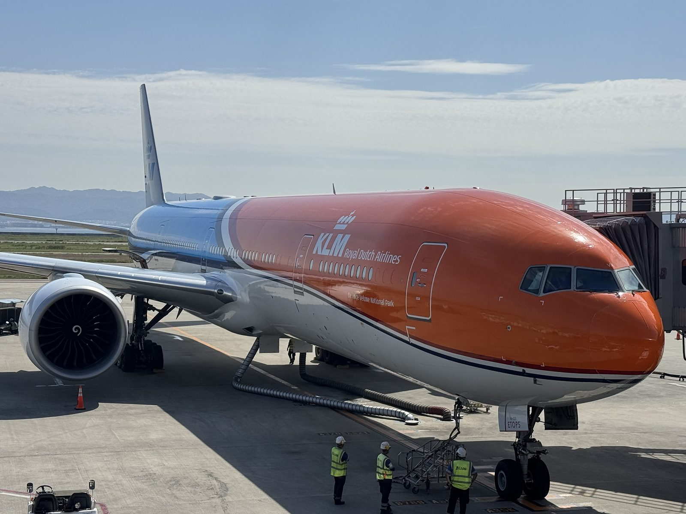
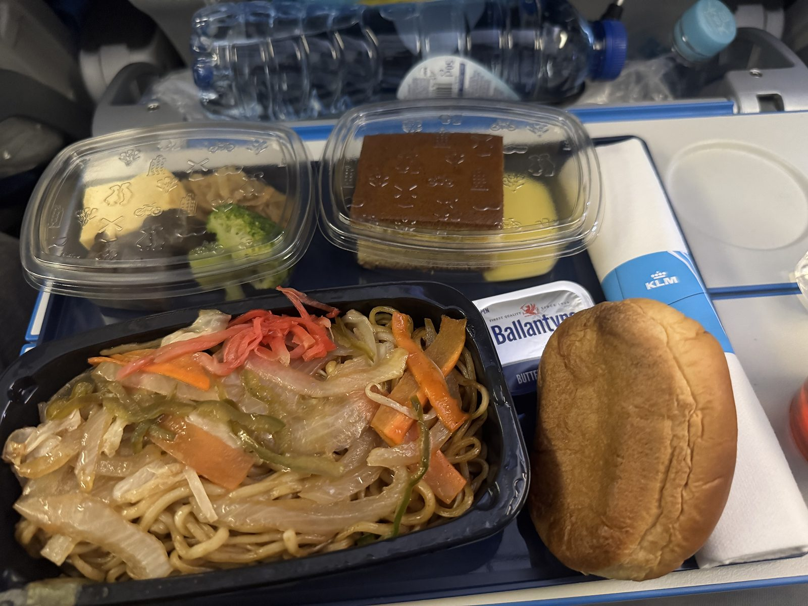
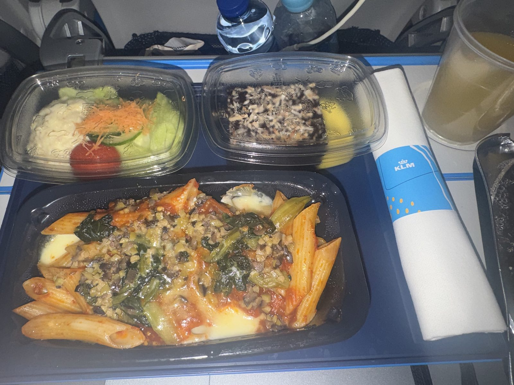
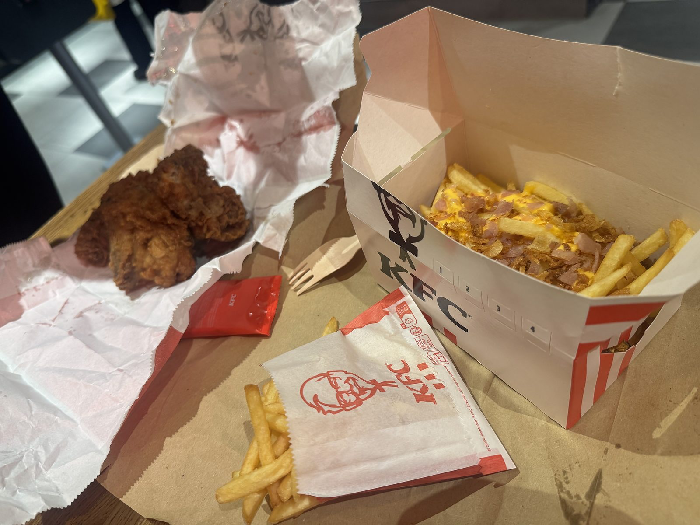
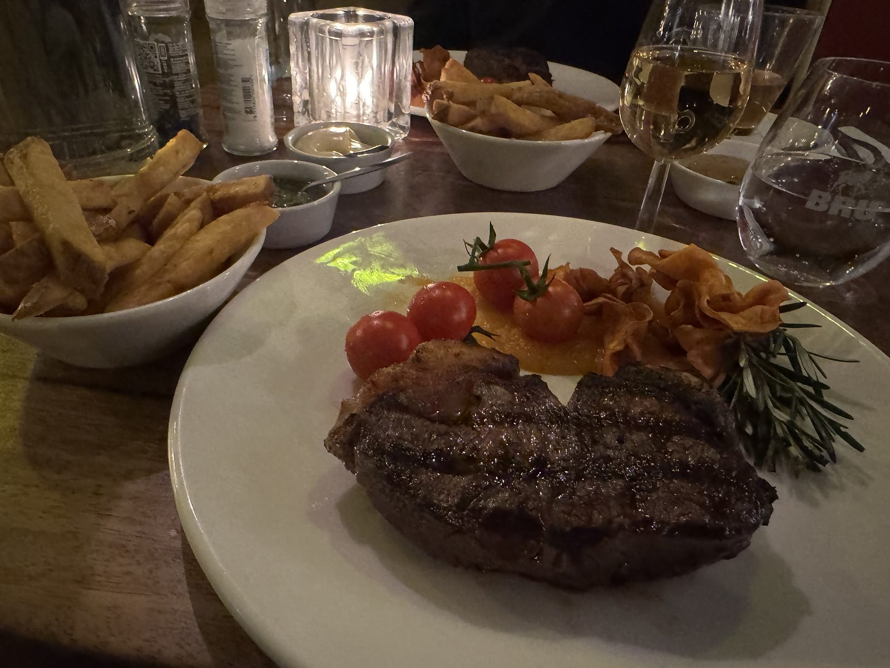

## オレンジの翼で

第0回のとんかつをあとに、関空を発ったのはKLMです。\
10月16日。オレンジの機体が、朝の光のなかで大きく光っていました。

空の上では、二度食事が運ばれてきます。\
最初は、紅しょうがをあしらった麺と、やわらかいパン。

続いてペンネ。\
トマトのソースにチーズが溶け、緑の葉がのっています。雲の上でいただく、あたたかい一皿でした。

## 着陸して、最初の一食

降りてすぐのKFCで、旅の初日が始まります。\
衣の立ったチキンと、チーズとベーコンをまとったポテト。

紙のフォークを手に、カリッとした衣から旅が始まります。\
遠い国に着いた実感が、この一口で届きました。

## ユトレヒトの夜、Meat & More

夜はユトレヒト。\
Mariastraat の Meat & More で、ステーキをいただきました。

表面にはきれいなグリルの跡。\
ミニトマトと香ばしい付け合わせが並び、フリットは白い器に山盛りです。ソースが二つ、小さな皿で添えられています。

グラスには白ワイン。\
肉の香りと、低い照明。着いた日の夜に、これ以上ない食卓でした。

===店舗情報===\
店名: Meat & More\
リンク: [公式サイト](https://www.meatandmore.nl/)\
住所: Mariastraat 8, 3511 LP Utrecht

## 次はブリュッセル

オランダの食卓は、空の上の麺と、ユトレヒトのステーキで一度閉じます。\
10月18日、向かう先はブリュッセルです。

**#2 ベルギー編に続く。**
