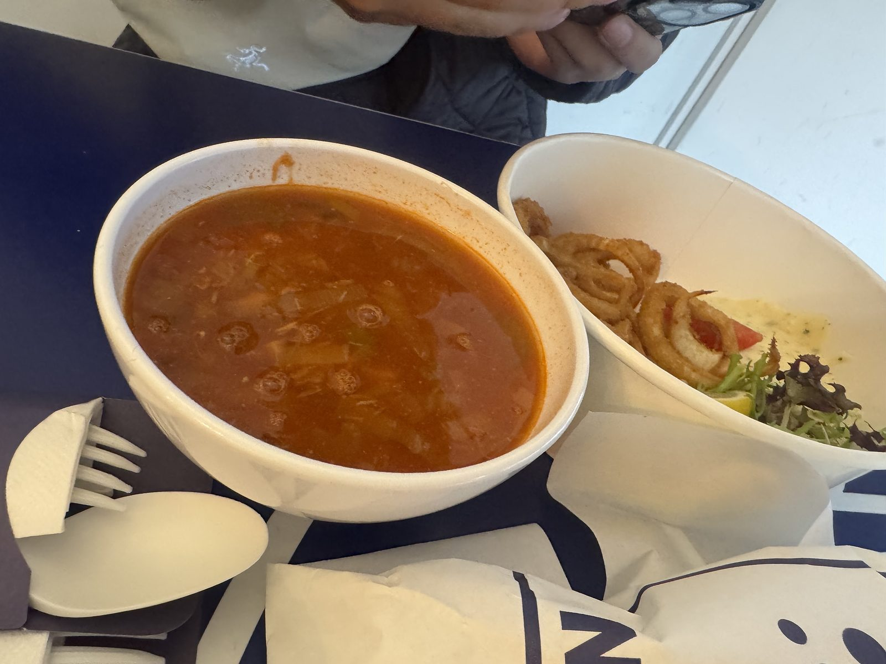
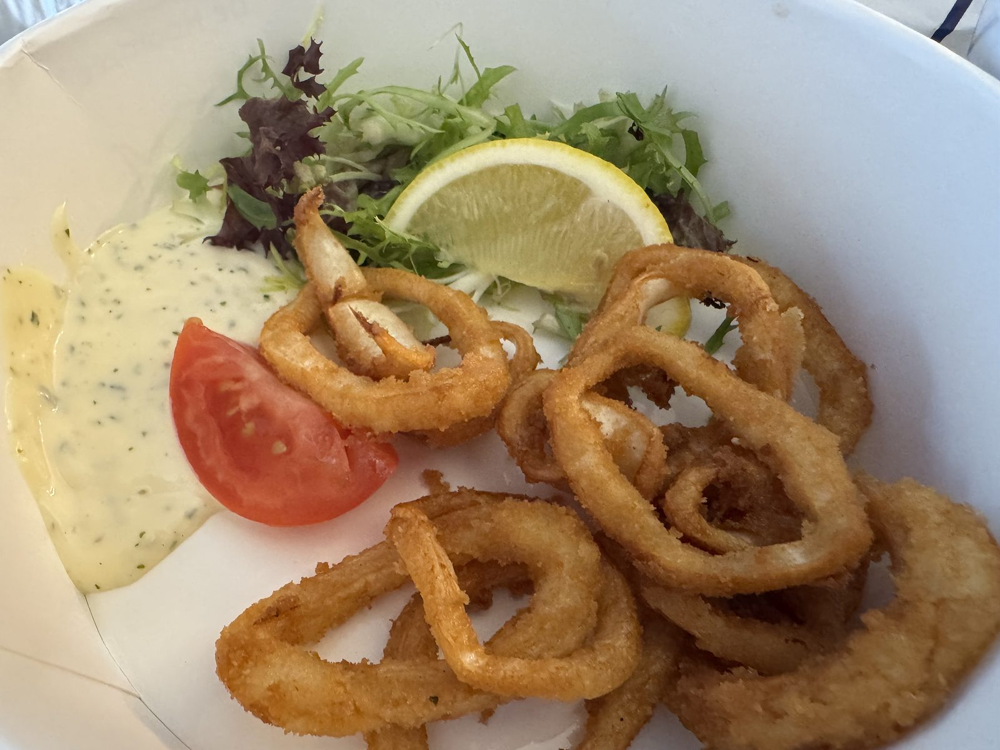
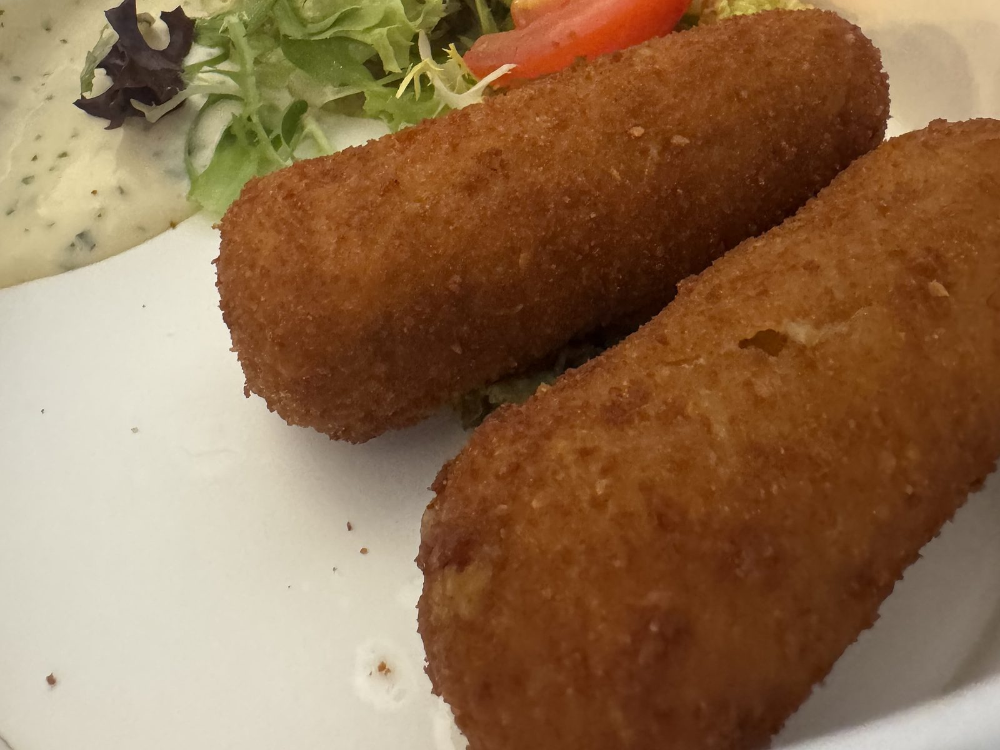
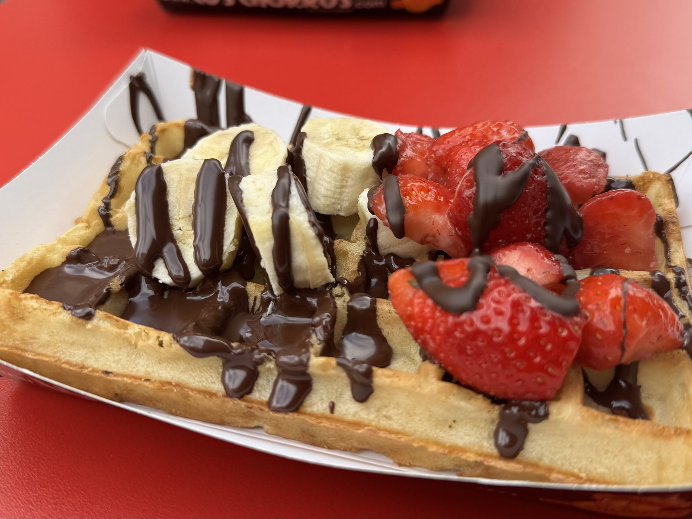
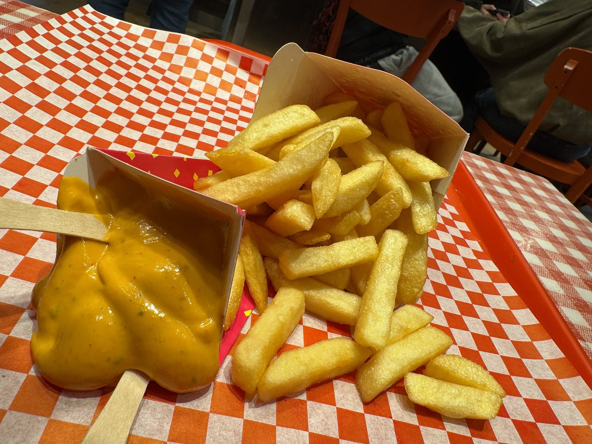
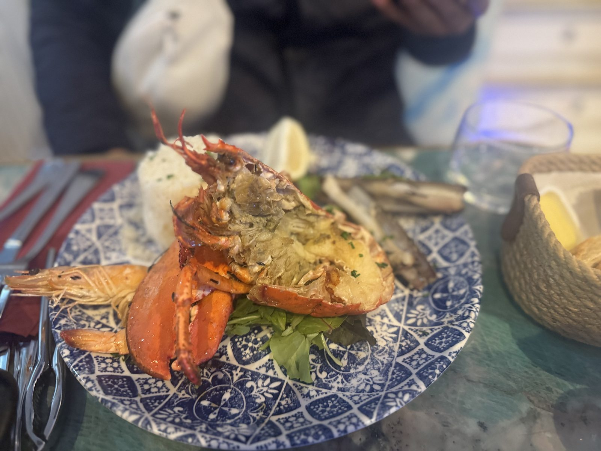
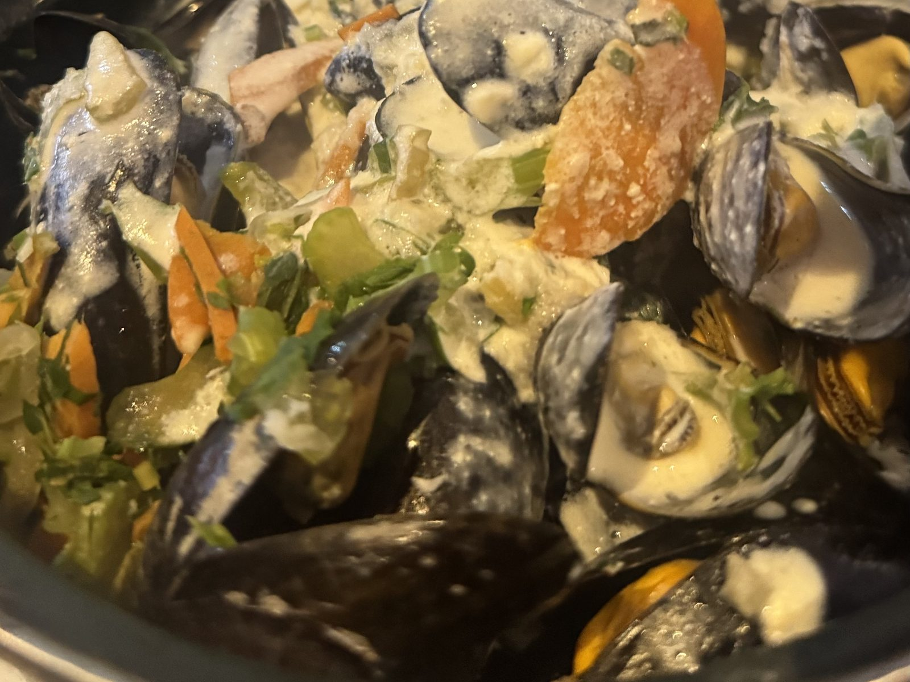
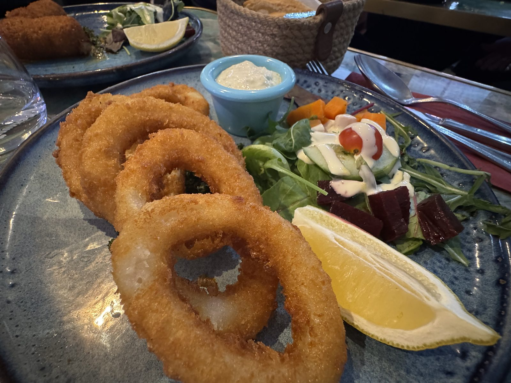
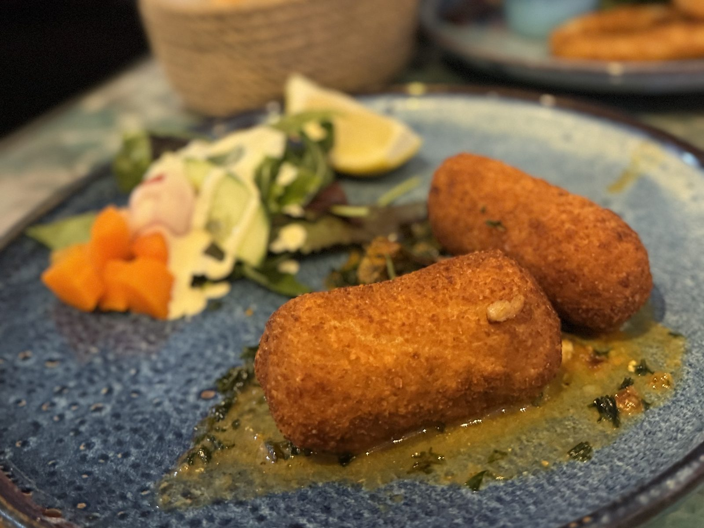
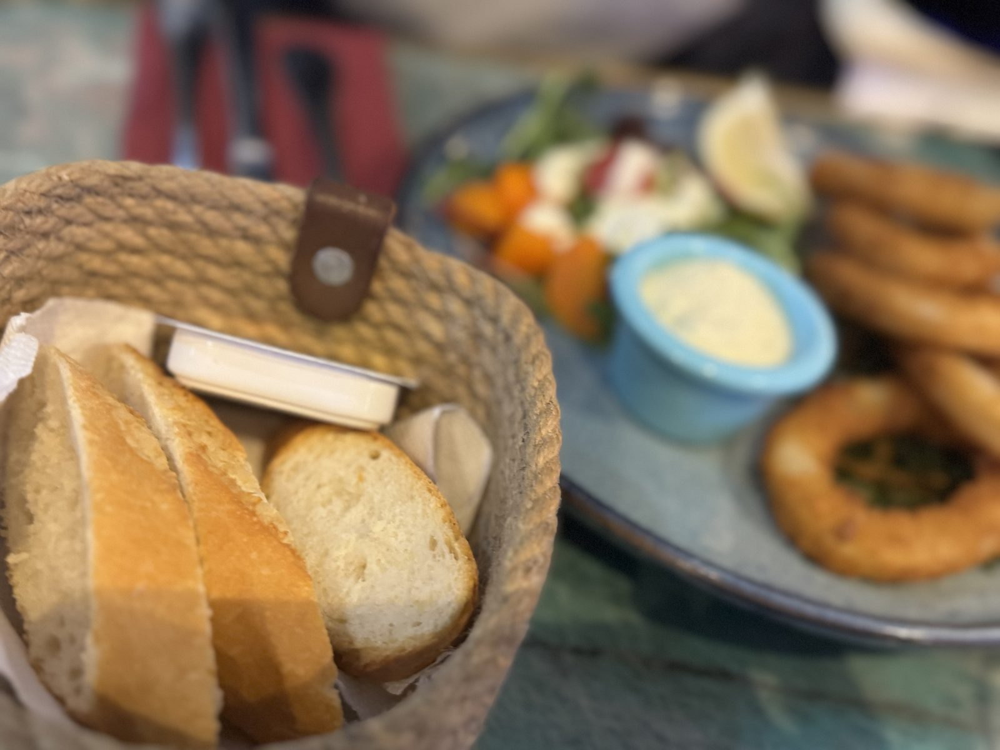

## サント＝カトリーヌの魚

10月18日、ブリュッセル。\
サント＝カトリーヌの Noordzee（Mer du Nord）は、立ち食いの魚屋です。

器は白い紙。テーブルは紺と白で、紙袋には N の字。\
最初に湯気を立てていたのは、トマトの魚スープです。隣の器にはイカリングと、ハーブの入ったタルタル。

イカリングは衣が薄く、金いろに揚がっています。\
レモンと、半分に切ったトマトがよく似合います。

エビのクロケットは二本。\
厚い衣がこんがりと、まっすぐに並んでいます。

===店舗情報===\
店名: Noordzee / Mer du Nord\
リンク: [公式サイト](https://noordzeemerdunord.be/)\
住所: Rue Sainte-Catherine 45, 1000 Bruxelles

## 赤いテーブルのワッフル

通りに出ると、赤いテーブルのワッフルが待っていました。\
バナナといちごの上を、チョコレートが細い線で渡っています。

焼きたての格子に、果物の水分がしみます。\
奥にはチュロスの箱。ブリュッセルの午後は、この甘さで一度立ち止まりました。

## フリッツとパプリカソース

ブリュッセルのフリッツは、紙のコーンに入ってやってきます。\
赤いチェックの紙の上で、黄金色のポテトがこぼれ、黄色いパプリカソースが木のフォークを待っています。

外はかりっと、中はほくほく。\
ソースは甘みとスパイスが一緒に来て、一本ごとに味が変わります。

## 小便小僧の近くで

夜は、小便小僧の近くの海鮮です。\
青い絵付けの皿、緑がかった大理石、ロープ編みのパンかご。卓が、すでにごちそうの顔をしていました。

中央に運ばれてきたのはロブスター。\
赤い殻、グリルした身。脇にはエビとマテ貝、白いごはんが添えられています。

ムール貝はクリーム仕立て。\
にんじんやセロリの甘みがソースに溶けて、貝の塩気をやわらげています。

イカリングは、こちらでも金いろ。\
ビーツとレモンのサラダが、揚げたての横で涼しげです。

エビのクロケットは、緑のソースの上に二本。\
衣はこんがりと色づき、ソースの青みがよく映えます。

バゲットに添えられたバターは、無塩でした。\
クリームのムールと交互に口へ運ぶと、塩気は海のほうに任せられます。

## 次はデュッセルドルフ

紙の器の魚から、ロブスターの卓まで。\
ブリュッセルの一日は、海の味で満ちていました。次は電車で、デュッセルドルフです。

**#3 ドイツ編に続く。**
