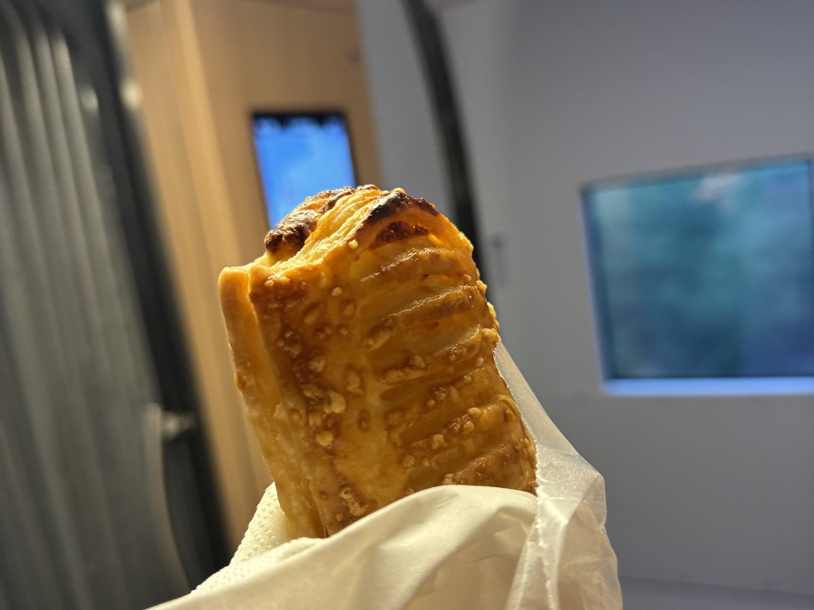
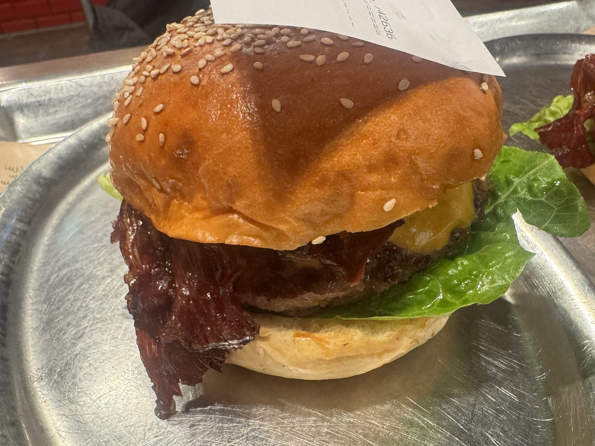
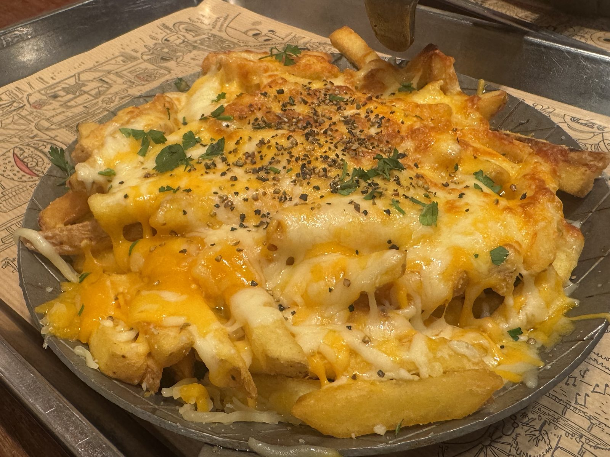
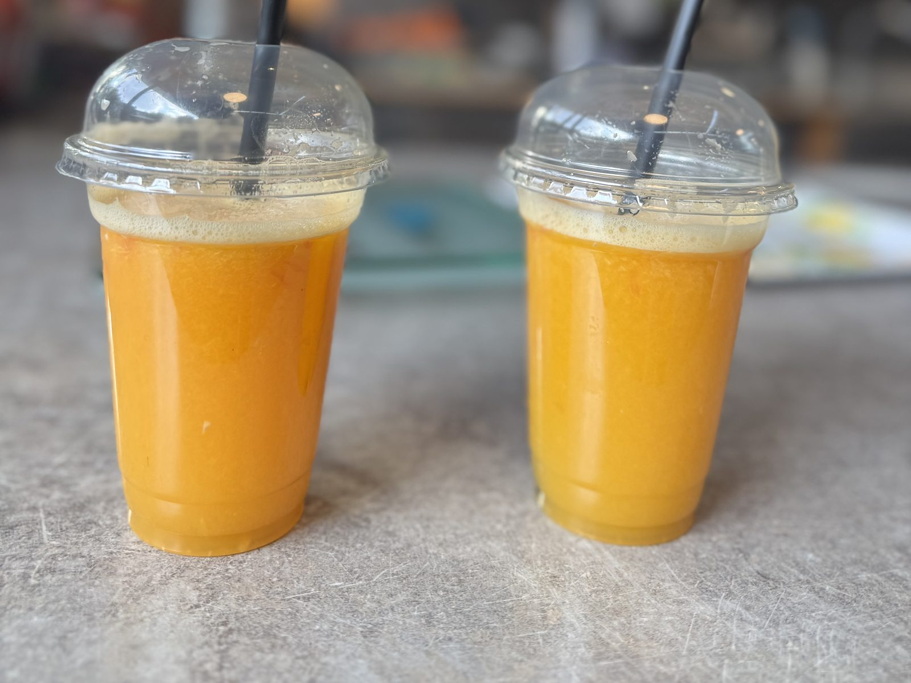
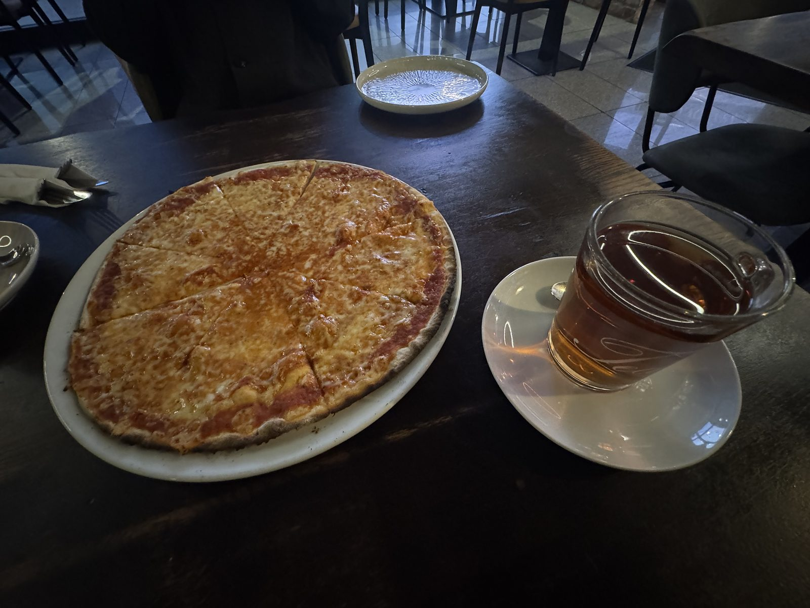
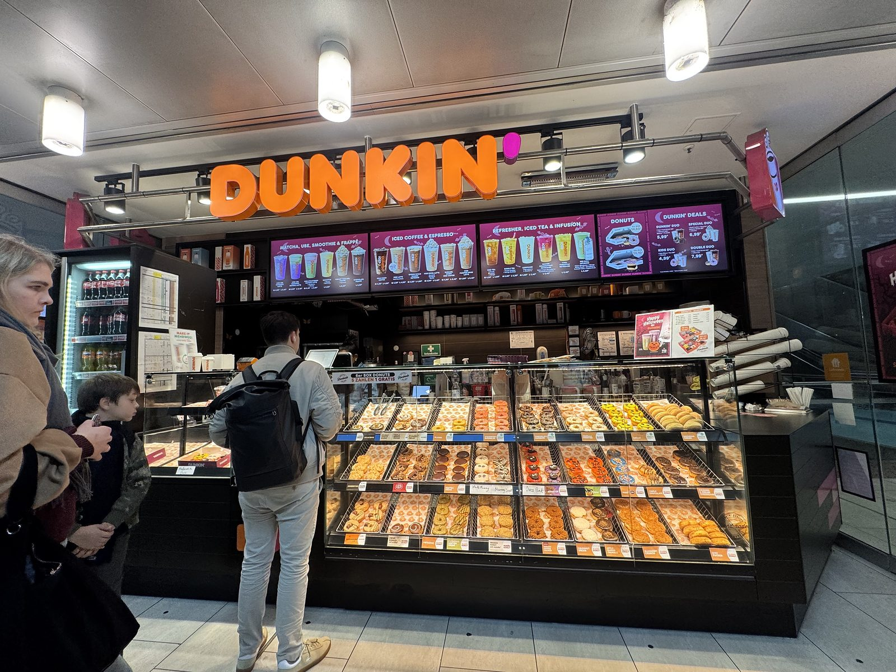

## 車窓のソーセージパン

10月19日。ブリュッセルからデュッセルドルフへ向かう電車です。\
手のなかにあったのは、ソーセージパン。

パイ生地は層になっていて、表面には香ばしい粒。\
窓の外が流れるあいだに、旅の朝ごはんは静かになくなっていきました。

## 日本人街の What's Beef

中央駅から近い、イマーマン通り。\
日本人街にある What's Beef で、ベーコンチーズバーガーをいただきました。

ゴマのバンズがつやつやと照り、チーズがとろりと落ちています。\
注文番号の紙が、バンズに刺さったまま。金属のトレーの上で、とても格好のよい一品です。

もう一皿はチーズフライ。\
チェダーが糸を引き、パセリと黒こしょうが一面に散っています。ポテトの形が、チーズの下でそっと隠れています。

===店舗情報===\
店名: What's Beef\
リンク: [公式サイト](https://whatsbeef.de/duesseldorf)\
住所: Immermannstraße 24, 40210 Düsseldorf

## 市場で絞るオレンジ

旧市街のカールスプラッツ。\
Saftladen では、頼んでからオレンジを絞ってもらいます。

カップの縁に、細かい泡。黒いストローが二本、市場の光のなかに立っていました。\
一口めで、皮の近い香りがします。

===店舗情報===\
店名: Saftladen Carlsplatz\
リンク: [カールスプラッツの紹介](https://www.carlsplatz-markt.de/marktleben/portrait/saftladen-carlsplatz)\
住所: Carlsplatz（スタンド E2）, 40213 Düsseldorf

## マルゲリータと紅茶

中央駅から二十分ほど歩いた店で、マルゲリータと紅茶です。\
チーズは縁まで均一に溶け、紅茶はガラスのカップで、澄んだ琥珀色をしていました。

大きな一枚を分けながら、午後がゆっくり過ぎていきます。\
旅の途中なのに、この卓だけ時間が止まって見えました。

## 中央駅のダンキン

日が傾くころ、デュッセルドルフ中央駅のダンキンへ。\
ガラスケースの中は、ドーナツの灯で満ちています。

色も形もさまざまで、選ぶこと自体が楽しい。\
駅の明かりの下でいただくドーナツは、この日の小さな結びになりました。

## まだ、途中

関空を出て四日目。デュッセルドルフの夜まで来ました。\
海と肉と、甘いもの。旅は、まだ続いています。

**つづく。**
